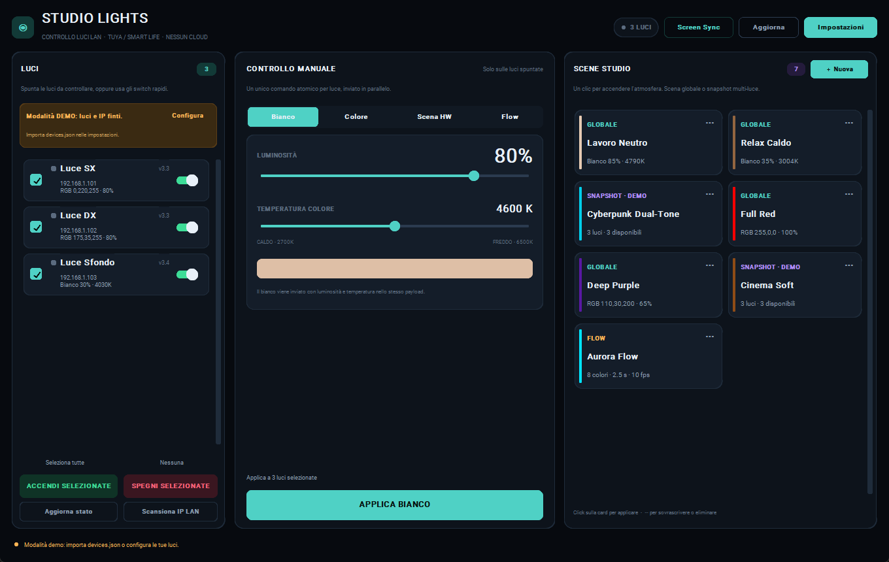
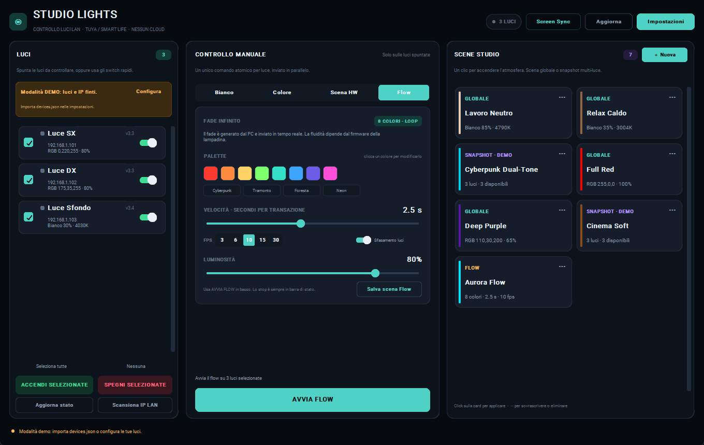
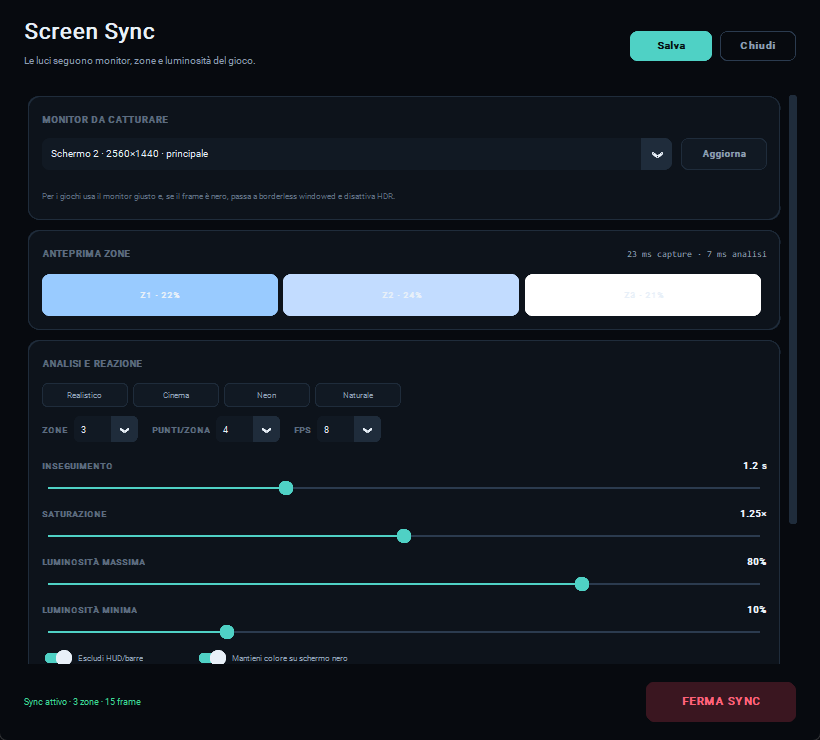
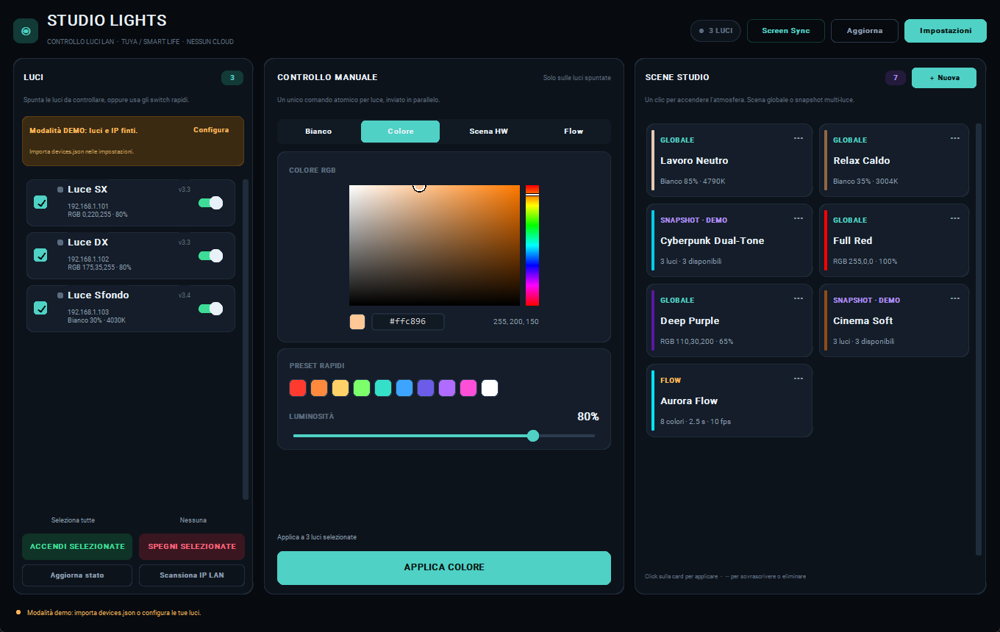
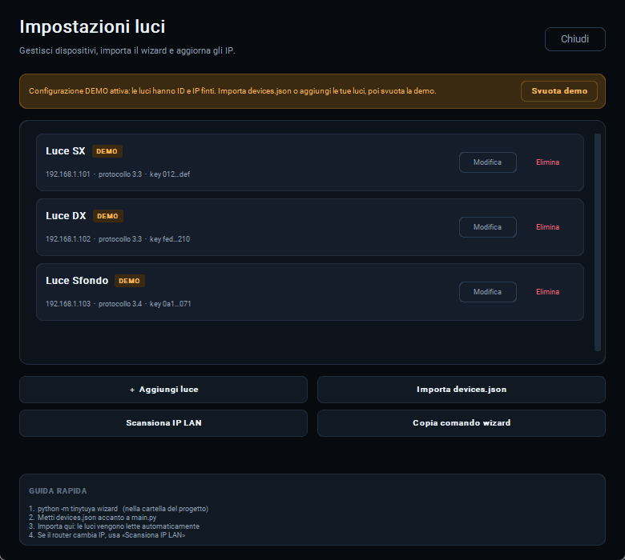

# Studio Lights

Controllo **locale LAN** per lampadine smart Tuya / Smart Life, pensato per uno studio
fotografico o una scrivania: scene multi-luce, colori indipendenti, bianco regolabile e
applicazione parallela a tutte le luci selezionate. Nessun cloud, nessuna attesa:
i comandi viaggiano direttamente sulla rete locale.



## Perché esiste

L'app Smart Life non permette di applicare colori diversi alle singole lampadine di un
gruppo nello stesso momento, né di salvare uno "snapshot" completo dello studio.
Studio Lights risolve questo con:

- **Scene Studio globali**: un colore/bianco + luminosità applicato alle luci spuntate.
- **Snapshot multi-luce**: ogni lampadina conserva il proprio colore, temperatura e
  luminosità, e viene ripristinata esattamente com'era.
- **Flow infinito**: fade graduale tra 8 colori, con velocità personalizzabile e
  sfasamento tra le luci per un effetto studio continuo.
- **Invio parallelo**: un `ThreadPoolExecutor` manda i comandi a tutte le luci insieme;
  ogni lampadina riceve **un solo payload atomico** (niente effetto "popcorn").
- **Timeout aggressivi**: una luce spenta dall'interruttore a muro non blocca l'interfaccia.

## Funzioni

- GUI dark mode in CustomTkinter, layout a tre pannelli.
- Lista luci con checkbox, switch ON/OFF rapido, "Seleziona tutte"/"Nessuna" e master
  **ACCENDI / SPEGNI SELEZIONATE**.
- Controllo manuale:
  - **Bianco**: luminosità 1–100% e temperatura colore caldo→freddo 0–100%.
  - **Colore**: color picker HSV visuale, preset rapidi, luminosità.
  - **Scene HW**: invio delle scene native del firmware Tuya (indice + payload opzionale).
  - **Flow**: fade infinito tra 8 colori, 0.5–5 s per transizione, 3/6/10/15/30 fps,
    sfasamento tra le luci e stop immediato.
- **Screen Sync**: le luci seguono il monitor del gioco, con 3/5/7 zone, 1/4/9 punti
  di campionamento per zona, smoothing, saturazione, limiti di luminosità e preset.
- **Scene Studio** salvabili/richiamabili con un clic, con tipo *Globale*, *Snapshot* o
  *Flow*. Sovrascrittura ed eliminazione dal menu `⋯` della card.
- Import automatico di `devices.json` (wizard tinytuya) e import manuale dalle impostazioni.
- Gestione luci completa: aggiunta, modifica, eliminazione, test di connessione.
- Scansione LAN con `tinytuya.deviceScan()` per riallineare gli IP cambiati dal router.
- Barra di stato con esito, latenza e luci offline; log rotante in `logs/`.

## Galleria

| Flow 8 colori | Screen Sync |
|---|---|
|  |  |

| Modalità colore | Impostazioni luci |
|---|---|
|  |  |


## Requisiti

- **Python 3.12+**
- Windows 10/11, macOS o Linux con Tk 8.6
- Lampadine Tuya / Smart Life con **Local Key** (protocolli 3.1–3.5; consigliati 3.3/3.4/3.5)
- PC e lampadine sulla **stessa rete locale**; niente VLAN isolate o client isolation

Dipendenze Python (installate automaticamente da `run.bat` / `run.sh`):

```
tinytuya>=1.20.0,<2
customtkinter>=6.0.0,<7
Pillow>=10.0.0,<14
mss>=9.0.0,<11
```

## Avvio rapido

### Windows

```bat
run.bat
```

Al primo avvio crea `.venv`, installa le dipendenze e lancia l'app senza finestra console.
Gli errori vengono scritti in `logs\studiolights.log`.

### macOS / Linux

```bash
chmod +x run.sh
./run.sh
```

### Avvio manuale

```powershell
python -m venv .venv
.\.venv\Scripts\python -m pip install -r requirements.txt
.\.venv\Scripts\python main.py
```

Su macOS/Linux: `python3 -m venv .venv && .venv/bin/pip install -r requirements.txt && .venv/bin/python main.py`.

## Configurare le lampadine

### 1. Ottenere le Local Key con il wizard

Nella cartella del progetto:

```powershell
.\.venv\Scripts\python -m tinytuya wizard
```

Il wizard chiede le credenziali del progetto **Tuya IoT Platform** (Access ID / Access
Secret), un Device ID qualsiasi e la region del progetto; servono solo a tinytuya per
leggere le Local Key una volta. Genera `devices.json`: mettilo accanto a `main.py`.
Se `tinytuya` è installato nel Python globale, va bene anche `python -m tinytuya wizard`.
Dalle Impostazioni puoi copiare il comando esatto con il pulsante **Copia comando wizard**.
Su macOS/Linux il comando del venv è `.venv/bin/python -m tinytuya wizard`.

> Se `devices.json` esiste e la configurazione è ancora quella demo, Studio Lights lo
> importa **automaticamente al primo avvio**. In alternativa:
> **Impostazioni → Importa devices.json**.

Il file `devices_template.json` è solo un modello/guida e non viene letto dall'app.

### 2. Inserimento manuale

**Impostazioni → + Aggiungi luce**, poi compila:

| Campo | Note |
|---|---|
| Nome | Etichetta libera, es. `Luce SX` |
| Device ID | dall'app Smart Life o da `devices.json` |
| IP locale | es. `192.168.1.50`; può essere aggiornato con la scansione |
| Local Key | 16 caratteri, segreta |
| Protocollo | 3.3 / 3.4 / 3.5 (disponibili anche 3.1/3.2) |

Il pulsante **Test connessione** legge lo stato reale e mostra protocollo e tipo di
lampadina. Se il test passa ma il comando fallisce, controlla versione e key.

### 3. IP cambiati dal router

**Scansiona IP LAN** esegue un broadcast UDP e riallinea gli IP delle luci configurate
tramite il Device ID. Non serve rifare il wizard.

## Uso quotidiano

1. Spunta le luci nel pannello **LUCI**.
2. Scegli il tab **Bianco**, **Colore**, **Scena HW** o **Flow**.
3. Regola i valori e premi **APPLICA …** (oppure **AVVIA FLOW**).
4. Salva l'atmosfera con **＋ Nuova** in **SCENE STUDIO**:
   - **Globale** salva i controlli manuali correnti e li applica alle luci spuntate al
     momento del richiamo;
   - **Snapshot Studio** salva lo stato individuale delle luci selezionate e lo ripristina
     esattamente, indipendentemente da cosa è spuntato dopo;
   - **Flow** salva palette, velocità, fps e sfasamento del tab Flow e li riavvia con un clic.
5. Un clic sulla card applica la scena; `⋯` permette di sovrascriverla con lo stato
   attuale o eliminarla.

> Lo **Snapshot** usa l'ultimo stato noto/applicato di ogni luce. Se hai cambiato le
> lampadine da Smart Life o da un altro telecomando, premi prima **Aggiorna stato**.

### Flow: fade infinito a 8 colori

1. Seleziona le luci, apri il tab **Flow**.
2. Clicca uno degli 8 campioni per cambiarlo, oppure carica un preset
   **Cyberpunk / Tramonto / Foresta / Neon**.
3. Imposta **Velocità** (0.5–5 s per transizione), **FPS** (3/6/10/15/30) e **Sfasamento luci**.
4. Premi **AVVIA FLOW**. Il fade continua finché non premi **■ STOP FLOW** in basso a
   destra o applichi un altro comando.
5. **Salva scena Flow** per ritrovare palette e velocità nella griglia scene.

> Il Flow non è una scena hardware Tuya: il fade viene interpolato dal PC e inviato come
> frame di colore. La fluidità dipende dal firmware della lampadina e dalla rete; se vedi
> scatti, abbassa gli FPS o aumenta i secondi per transizione. Ogni lampadina ha al massimo
> un frame in volo, quindi una luce offline non blocca le altre.

Scorciatoie: `F5` aggiorna lo stato, `Ctrl+N` crea una scena.

### Screen Sync: luci reattive allo schermo

1. Seleziona le luci che vuoi animare.
2. Clicca **Screen Sync** nell'header.
3. Scegli il **monitor del gioco** (quello corretto, non il desktop).
4. Imposta:
   - **Zone** 3/5/7: quante fasce verticali analizzare;
   - **Punti/zona** 1/4/9: quanti campioni per zona (griglia 1×1, 2×2, 3×3);
   - **FPS** 5/8/10/15 dell'analisi e dell'invio;
   - **Inseguimento** (0.3–3 s), saturazione, luminosità minima/massima;
   - **Escludi HUD/barre** e **Mantieni colore su schermo nero**.
5. Nella mappa **LUCI → ZONE**, assegna ogni lampadina a una zona o a **Globale**.
6. Premi **AVVIA SYNC**. Il pulsante **■ STOP SYNC** appare nella barra di stato.

Per i giochi: **borderless windowed**, HDR disattivato. In fullscreen exclusive alcuni
giochi danno frame neri; in quel caso l'app lo segnala e non invia nero alle luci.
Screen Sync e Flow sono mutuamente esclusivi; qualsiasi comando manuale ferma il sync.
Le impostazioni vengono salvate in `screen_sync.json` (runtime, ignorato da Git) e sono
ripristinate al riavvio. Le modifiche a monitor, numero di zone e mappa luci si applicano
al successivo **Avvia Sync**; ferma e riavvia per cambiarle.

## File di configurazione

Tutti i file stanno nella root del progetto e vengono creati automaticamente se mancanti.
I file runtime (`lights_config.json`, `scenes.json`, `screen_sync.json`, `devices.json`, `tinytuya.json`,
`tuya-raw.json`, `snapshot.json`) sono **ignorati da Git** perché possono contenere Local
Key o dati personali. Nel repository trovi solo i modelli `lights_config.example.json`,
`scenes.example.json` e `screen_sync.example.json`.

### `lights_config.json`

```json
{
  "schema_version": 1,
  "demo": false,
  "updated_at": "2026-11-06T10:00:00+00:00",
  "devices": [
    {
      "name": "Luce SX",
      "id": "bf0123456789abcdef01",
      "ip": "192.168.1.101",
      "key": "0123456789abcdef",
      "version": "3.3",
      "state": {
        "power": true, "mode": "colour", "brightness": 80,
        "colortemp": 50, "rgb": [0, 220, 255],
        "hw_scene": null, "hw_data": null
      }
    }
  ]
}
```

### `scenes.json`

```json
{
  "schema_version": 1,
  "scenes": [
    {
      "id": "scn_esempio",
      "name": "Cyberpunk Dual-Tone",
      "type": "snapshot",
      "demo": false,
      "state": { "power": true, "mode": "colour", "brightness": 85,
                 "colortemp": 50, "rgb": [0, 225, 255],
                 "hw_scene": null, "hw_data": null },
      "lights": {
        "bf0123456789abcdef01": { "power": true, "mode": "colour",
          "brightness": 85, "colortemp": 50, "rgb": [0, 225, 255],
          "hw_scene": null, "hw_data": null }
      }
    },
    {
      "id": "scn_aurora_flow",
      "name": "Aurora Flow",
      "type": "flow",
      "demo": false,
      "flow": {
        "palette": ["#00e5ff", "#35e0c8", "#7cff6b", "#3da5ff",
                    "#6c5ce7", "#ff4fd8", "#ff8a3d", "#ffd166"],
        "segment_seconds": 2.5,
        "fps": 10,
        "phase_offset": true,
        "brightness": 75
      }
    }
  ]
}
```

`type` può essere `global`, `snapshot` o `flow`. Le scene demo con `"demo": true` che non
trovano le luci originali vengono adattate, in ordine, alle luci selezionate: utile per
provare l'app prima di configurare l'hardware. Le scene create da te non hanno questo
fallback. Una scena `flow` viene avviata sulle luci selezionate al momento del richiamo e
non contiene stati per singola luce.

## Sicurezza

- La **Local Key** è un segreto: chi la possiede e ha accesso alla LAN può controllare la
  lampadina. Non condividerla.
- `.gitignore` esclude tutti i file runtime con key o dati personali: `devices.json`,
  `lights_config.json`, `scenes.json`, `screen_sync.json`, `tinytuya.json`, `tuya-raw.json`, `snapshot.json`,
  log e backup. I file `*.example.json` tracciati contengono solo dati demo.
- Non forzare l'aggiunta di questi file con `git add -f`: finirebbero nella cronologia.
- L'app non contatta il cloud: parla solo con gli IP in `lights_config.json` sulla porta
  TCP 6668. Il wizard tinytuya è l'unico passaggio cloud, e serve solo a ottenere le key.

## Struttura del progetto

```
main.py                      entry point + gestione errori/DPI
run.bat / run.sh             avvio rapido con venv
lights_config.example.json   modello luci + stato (demo)
scenes.example.json          7 scene demo, inclusa Aurora Flow
screen_sync.example.json     modello configurazione Screen Sync
devices_template.json        modello per il wizard
assets/                      icona app (PNG/ICO)
docs/                        screenshot
studiolights/
  models.py                  LightDevice, LightState, FlowConfig, Scene, report
  config.py                  persistenza atomica, import devices.json, seed
  controller.py              tinytuya, ThreadPoolExecutor, timeout, DPS atomici
  flow.py                    motore fade host-side, un frame in volo per luce
  screen_sync.py             cattura mss, analisi zone, smoothing, streamer schermo
  defaults.py                dati demo
  theme.py                   palette dark
  util.py                    JSON, log, colore/Kelvin/interpolazione
  ui/app.py                  finestra principale, tab Flow, scene
  ui/screen_sync.py          finestra di configurazione Screen Sync
  ui/widgets.py              riga luce, card scena
  ui/colorpicker.py          picker HSV con Pillow
  ui/dialogs.py              impostazioni, editor luce, scene, palette, conferme
tests/test_core.py           19 test senza hardware
tests/test_screen_sync.py    7 test Screen Sync senza monitor/Tuya
tools/make_icon.py           rigenera l'icona
```

## Test

```powershell
.\.venv\Scripts\python -m unittest discover -s tests -v
```

I test coprono modelli, validazione, persistenza, import wizard, seed scene, payload DPS
atomici, classificazione errori, matching IP, interpolazione colori, motore Flow
(invio frame, stop, sfasamento) e Screen Sync (config, zone, HUD, letterbox, smoothing,
runner con capture finta). Non richiedono lampadine reali.

Totale attuale: **26 test** (19 core + 7 Screen Sync).

## Troubleshooting

| Sintomo | Causa / soluzione |
|---|---|
| `Network Error: Device Unreachable` | luce spenta dall'interruttore, IP cambiato, firewall, VLAN. Usa **Scansiona IP LAN** e verifica il ping. |
| `Check device key or version` | Local Key errata o protocollo sbagliato: prova 3.3, 3.4, 3.5. |
| La luce accende ma il colore no | modello solo bianco (CCT) o DP colore non esposto; il test mostra il tipo. |
| Scena HW non funziona | le scene sono specifiche del firmware; prova indici 1–4, poi il payload Type B. |
| Flow a scatti | abbassa gli FPS (3 o 6), aumenta i secondi per transizione, avvicina le luci al router; il fade è generato dal PC, non dal firmware. |
| Flow non parte | nessuna luce selezionata, oppure tutte offline; controlla la barra di stato. |
| Screen Sync: schermo nero | il gioco è in fullscreen exclusive o HDR/DRM: passa a borderless e disattiva HDR. |
| Screen Sync non reagisce | controlla monitor, mappa luci → zone, luci selezionate e che il gioco sia sul monitor scelto. |
| Screen Sync a scatti | abbassa FPS e saturazione; alza l'inseguimento (2–3 s) o avvicina le luci al router. |
| Screen Sync: colori piatti | alza la saturazione o usa il preset Neon; il firmware può limitare la fedeltà colore. |
| Temperatura invertita | alcuni modelli mappano 0 = freddo. È documentato come limite noto. |
| La GUI si blocca | non dovrebbe: i comandi sono in thread. Controlla `logs/studiolights.log`. |
| La scansione non trova nulla | UDP broadcast bloccato dal firewall o rete guest/client isolation. |

## Limiti noti

- Il progetto è stato provato con tre lampadine A60 RGB+CW reali; la resa fine di Flow e
  Screen Sync sul firmware va comunque tarata. I test automatici coprono logica, payload,
  GUI e analisi schermo.
- Le scene hardware e la direzione della temperatura variano per modello/firmware.
- Il colore viene inviato con il valore HSV scelto dal picker; la luminosità è un DP
  separato, quindi la resa percepita dipende dal firmware.
- Il Flow è un'animazione software: 3–30 frame/s, con ACK per frame per mantenere la socket
  sincronizzata. Su firmware lenti il fade può risultare a gradini. Non è una scena
  hardware e non continua se l'app viene chiusa.
- Screen Sync cattura il monitor con `mss` ed è pensato per **Windows**. Non gestisce
  contenuti DRM, HDR o fullscreen exclusive senza borderless; non fa riconoscimento
  semantico della scena, ma campiona colori e luminosità.
- La cattura schermo resta in RAM: nessun frame viene salvato o inviato in cloud.
- Non c'è autenticazione locale: chi apre l'app sul PC può comandare le luci.

## Stack

Python 3.12 · [tinytuya](https://github.com/jasonacox/tinytuya) 1.20 · CustomTkinter 6 ·
Pillow · mss · Tkinter · ThreadPoolExecutor · FlowRunner · ScreenSyncRunner.
Nessun servizio cloud a runtime.
